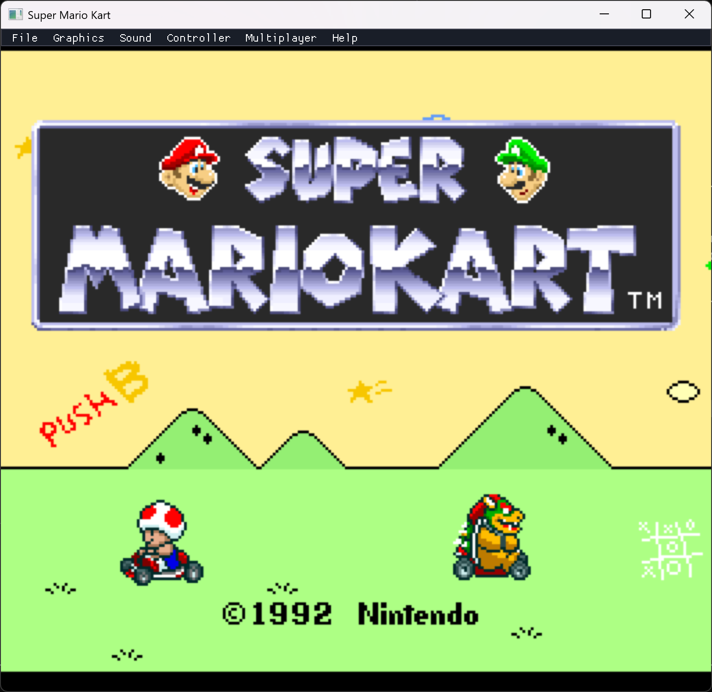
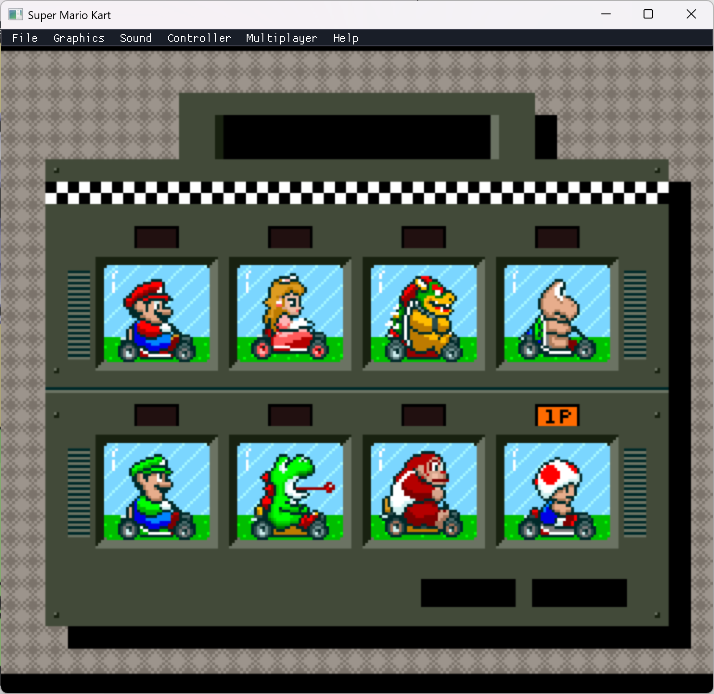
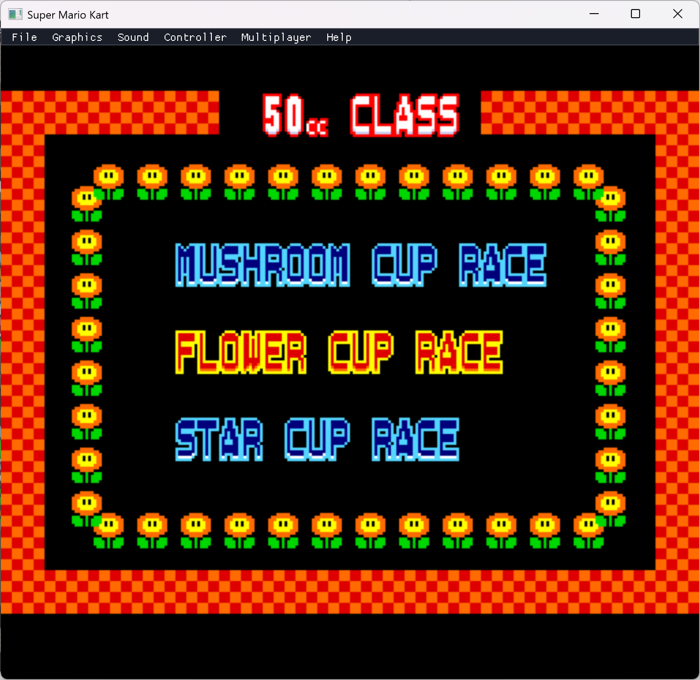
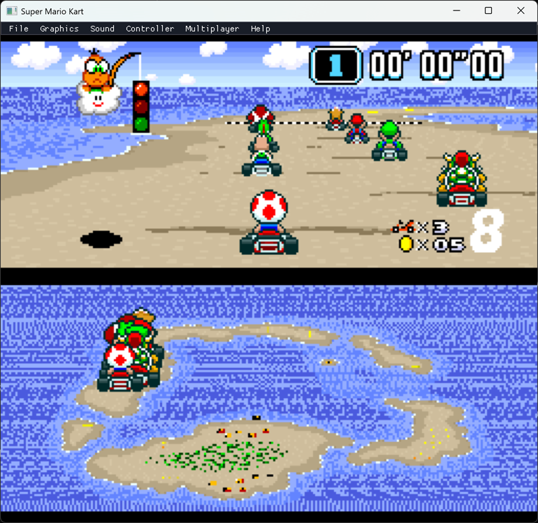
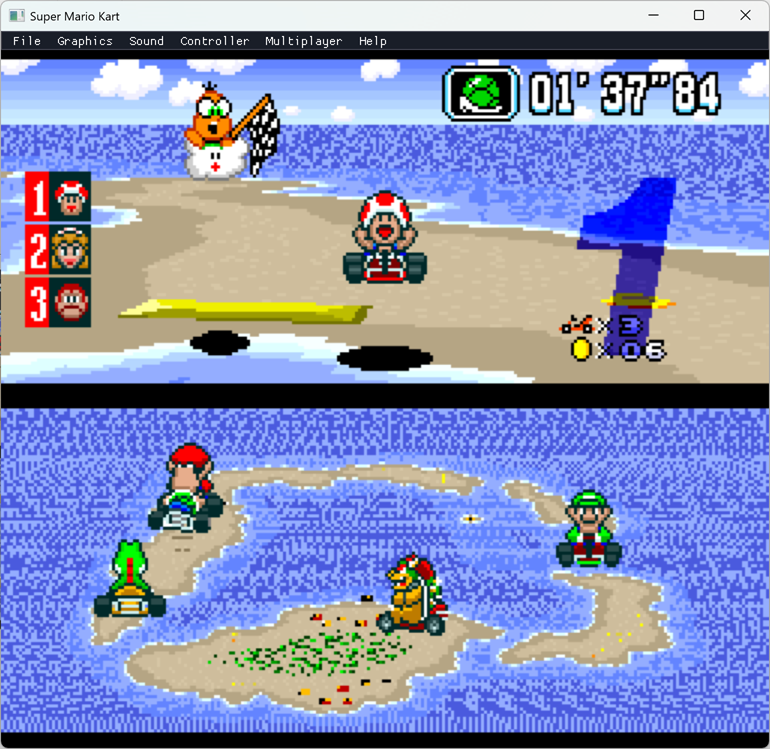
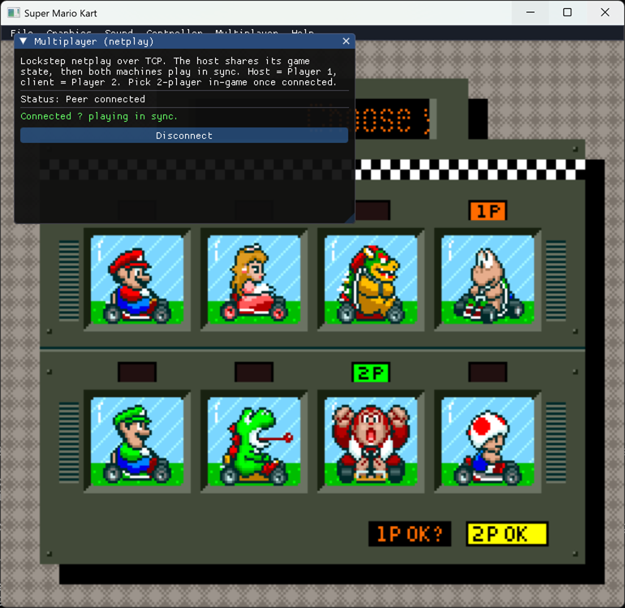

# Super Mario Kart — Static Recompilation

Static recompilation of **Super Mario Kart** (SNES, 1992) from WDC 65C816 assembly to
native C, built on [snesrecomp](https://github.com/sp00nznet/snesrecomp) and playable on
modern hardware via SDL2.

Follows the recomp house style shared with snesrecomp, lynxrecomp, xboxrecomp,
ps3recomp and pcrecomp: the toolkit lives in its own repo, generated code is
never committed, and every build runs headless.

## Status

**Alpha. Unversioned.** **Playable end-to-end.** A cold boot walks the authentic flow from controller input —
title → driver select → 50cc class / cup select → a live **Mode-7 race** — with a Dear
ImGui menu bar, save-states, configurable keyboard + gamepad controls for two players, and
**lockstep netplay**. The SNES hardware (PPU Modes 0–7, SPC700 + DSP audio, DMA/HDMA, DSP-1
coprocessor) is fully emulated by the LakeSnes backend.

Two execution paths share the same backend: **real-frame mode** (the default) runs the
genuine ROM through LakeSnes's cycle-accurate frame, so the whole game plays today; the
**recompiled-shell path** (`SMK_SHELLS=1`) runs hand-written `RECOMP_PATCH` functions and is
where the static-recompilation work grows incrementally. Recompiled functions are defined
with `RECOMP_PATCH(name, snes_addr) { ... }` and auto-register in snesrecomp's dispatch table
at static-init time — adding a translated function is a one-line change, no central list.

### What works
- **Full authentic flow from controller input** — title → driver select → 50cc class / cup
  select → Mode-7 race, all driven by the genuine ROM's state sequencer (`$81:E000`)
- **Mode-7 race** rendering + gameplay: perspective track, karts, HUD, lap timer, split-screen
- **Dear ImGui menu** overlaying the game — File / Graphics / Sound / Controller / Multiplayer / Help
- **Save-states** — File → Save/Load (and F5/F8), full machine state via LakeSnes; File → New resets
- **Configurable input** for **both players** — rebind keyboard *and* Xbox-style gamepad per button
- **Lockstep netplay** (TCP) with input-delay buffering — host/join, save-state sync on connect,
  deterministic in-sync emulation (verified by matching WRAM checksums)
- Full boot chain: reset vector → hardware init → WRAM 0x55 fill → PPU/APU/DSP-1 setup → Mode-7 tables
- Custom tile/tilemap decompressor (`$84:E09E`) — all 7 compression modes + E0+ extended counts
- Joypad/auto-joypad input with edge detection; real palettes ROM → CGRAM; per-scanline HDMA
- LakeSnes renders all PPU scanlines per frame; SDL2 window (3× scale by default), 60 fps, audio

What's next: [ROADMAP.md](ROADMAP.md).

## Screenshots



The full menu flow runs from controller input — title → driver select → class/cup select:





The Mode-7 race renders and plays — perspective track, karts, HUD, split-screen:




**Lockstep netplay** — two machines run the same deterministic emulation in sync (host =
Player 1, client = Player 2), starting from a shared save-state:



## Getting Started

A one-click `Setup.cmd` is not written yet ([ROADMAP.md](ROADMAP.md)). Step by step, on
Windows:

1. Install the prerequisites:
   - Visual Studio 2022 (or its Build Tools) with *Desktop development with C++*
   - CMake 3.16+ (bundled with Visual Studio; `cmake --version` in a Developer prompt)
   - Git
   - SDL2 through vcpkg: `vcpkg install sdl2:x64-windows`
   - Python 3.10+ only for the tools (`py --version`; if `python` opens the Microsoft
     Store, use `py`)
2. Clone with submodules (snesrecomp and LakeSnes are submodules; without
   `--recursive` CMake stops at `add_subdirectory(ext/snesrecomp)`):
   ```
   git clone --recursive https://github.com/sp00nznet/mk.git
   cd mk
   ```
3. Configure and build:
   ```
   cmake -B build -G "Visual Studio 17 2022" -A x64 -DCMAKE_TOOLCHAIN_FILE=C:/vcpkg/scripts/buildsystems/vcpkg.cmake
   cmake --build build --config Release
   ```
4. Copy `SDL2.dll` from `C:/vcpkg/installed/x64-windows/bin` next to
   `build/Release/smk_launcher.exe` (vcpkg usually does this for you).
5. Supply your own ROM: the US v1.0 cartridge dump, MD5 `7f25ce5a283d902694c52fb1152fa61a`.
   It is not included and never will be.
6. Run it:
   ```
   build/Release/smk_launcher.exe "Super Mario Kart (USA).sfc"
   ```
   The console prints `smk: REAL-FRAME mode (full LakeSnes execution)` and the title
   screen appears.

## Usage

```
smk_launcher.exe <rom.sfc>                              play (real-frame mode, the default)
smk_launcher.exe <rom.sfc> --headless --record out.mp4  no window; frames piped to ffmpeg
SMK_SHELLS=1 smk_launcher.exe <rom.sfc>                 the recompiled-shell path
```

By default the launcher runs in **real-frame mode**: the genuine ROM via LakeSnes's
cycle-accurate frame, so menus *and* the Mode-7 race play at full speed. The
recompiled per-frame shells (`SMK_SHELLS=1`) can't yet drive the race's multi-frame
setup; as gameplay functions are recompiled they take over.

Headless runs take snesrecomp's capture variables, for example
`SNESRECOMP_SHOT_FRAMES=600 SNESRECOMP_EXIT_FRAME=610` (screenshot at frame 600, then
exit). The full list is in snesrecomp's `docs/runtime.md`.

### Controls

Default Player 1 keyboard (rebindable in the menu):

| Key | SNES Button |
|-----|-------------|
| Arrow keys | D-pad |
| Z | B |
| X | Y |
| A | A |
| S | X |
| Q | L |
| W | R |
| Enter | Start |
| Right Shift | Select |
| F5 / F8 | Save / Load state |
| Escape | Quit |

**Gamepads** (Xbox-style, via SDL_GameController) work out of the box for both
players — A→B, B→A, X→Y, Y→X, shoulders→L/R, Back→Select, Start→Start, d-pad and
left stick steer. Rebind any of it in **Controller** (P1/P2 tabs).

### Menu

A Dear ImGui menu bar (modelled on [LinksAwakening](https://github.com/sp00nznet/LinksAwakening))
overlays the game:

- **File** — New (reset/restart), Save / Load state (`smk_state.sav`; also **F5 / F8**),
  Settings ▸ (save/load `smk_config.ini`), Quit
- **Graphics** — window scale, V-Sync, texture filter, scanlines, show FPS
- **Sound** — master volume, mute
- **Controller** — rebind keyboard **and** gamepad for **Player 1 and Player 2**
- **Multiplayer** — Host / Join (IP:port), input-delay, connection status — lockstep netplay
- **Help → About** — links back to this repository

The menu auto-disables in headless/scripted runs (`SMK_HEADLESS`/`SMK_SCRIPT`).

## Building from source

As in Getting Started. Optional: `src/recomp/smk_autogen.c`, the cycle-accurate
routines generated from your ROM by `tools/recomp/autogen.py`, is built in when present
(see [docs/autogen.md](docs/autogen.md)). The netlab farm cross-builds with mingw-w64
(`projects/mk.env` in recomp-netlab).

## Documentation

- [docs/architecture.md](docs/architecture.md): layers, project structure, the decompressor, ROM details, references.
- [docs/autogen.md](docs/autogen.md): generating `smk_autogen.c` locally.
- [docs/smk_flow_re.md](docs/smk_flow_re.md): reverse-engineering the menu → race flow.
- [docs/own_recompiler_design.md](docs/own_recompiler_design.md), [docs/recomp_frame_model_plan.md](docs/recomp_frame_model_plan.md), [docs/mode7_track_fix_plan.md](docs/mode7_track_fix_plan.md), [docs/mstan_recompiler_spike.md](docs/mstan_recompiler_spike.md): design notes.
- [docs/history.md](docs/history.md): milestones before the changelog.

## Contributors

See [CONTRIBUTORS.md](CONTRIBUTORS.md). Contributions: [CONTRIBUTING.md](CONTRIBUTING.md).

## Legal

This project contains no Nintendo copyrighted material. The ROM is not included and
must be legally obtained. Source generated from the ROM (`smk_autogen.c`) is never
distributed: you generate it on your own machine. BizHawk, snes9x and Mesen are run only
as separate black-box references to compare output against; none of their code is here.

## License

MIT, see [LICENSE](LICENSE). snesrecomp, LakeSnes and Dear ImGui carry their own
licences (see `ext/snesrecomp/NOTICE`).
